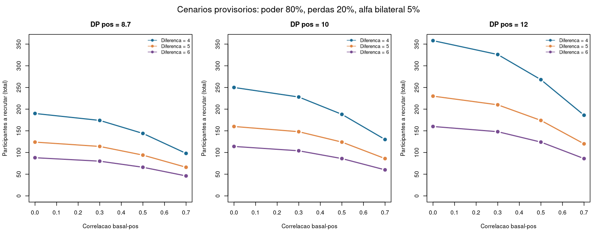
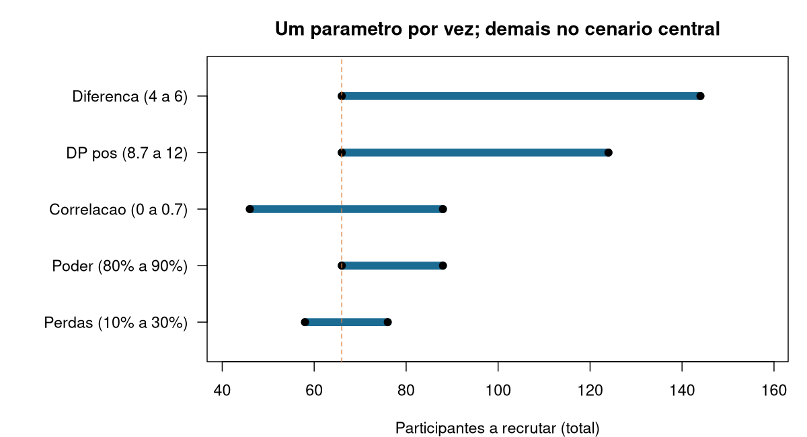
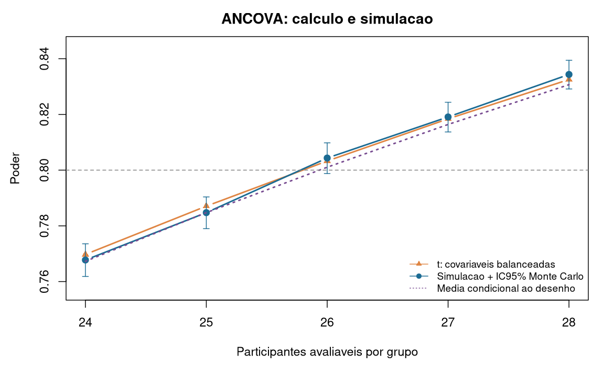

## Escopo e resultado a ser interpretado

Este relatório audita os parâmetros e implementa o planejamento do ensaio
descrito no projeto de Nathalia Rabelo Buzalaf Zanardini de Lara. Os materiais
fornecidos foram o projeto em DOCX, Freire et al. (2007), Clough et al. (2012)
e o pedido de análise. Não foram fornecidos dados individuais clínicos nem
abundâncias laboratoriais individuais.

Atualização de 30/10/2026: a meta de **66 participantes, com meta de 33 por
braço e previsão de 20% de perdas**, foi confirmada. A pesquisa externa e as
justificativas estão em [fundamentação atualizada](docs/fundamentacao_20261030.md).
O [projeto Word revisado](docs/projeto_revisado_calculo_randomizacao.docx) incorpora
o cálculo e o procedimento de randomização em R/Excel. A auditoria dos parágrafos
Pxxxx abaixo continua se referindo ao documento original, preservado em `references/`.

Os resultados clínicos são **condicionais às premissas de planejamento**.
Executar corretamente uma fórmula ou reproduzi-la por simulação não demonstra
que o DP, a correlação ou a diferença-alvo serão observados no ensaio.
O cálculo do IAH não assegura poder de 80% para cada biomarcador ou para
todas as análises exploratórias.

O fluxo utiliza R e seus pacotes básicos. A versão e a sessão efetivamente
utilizadas estão registradas nos arquivos de execução em `outputs/`.
O [README](README.md) explica a execução no RStudio. Os parâmetros editáveis
estão centralizados em [R/01_parameters.R](R/01_parameters.R).
Os números apresentados na seção seguinte são produzidos pelo fluxo R;
o restante do relatório documenta sua interpretação e as fontes.

## Resultados executados em R

Execução: R version 4.5.0 (2025-04-11). Premissas centrais de planejamento: DP pós 8.7, correlação 0.5, diferença 6.0 eventos/h; alfa bilateral 5%, poder 80%, perdas 20%; 2 covariáveis.

**Dimensionamento condicional: 26 avaliáveis por grupo; 33 recrutados por grupo (66 no total).** A aproximação normal retorna 24.7534, arredondada para 25 avaliáveis. O cálculo com t e 48 graus de liberdade retorna 26, com poder 80.33% sob balanceamento das covariáveis.

O DP residual usado foi 7.534421 eventos/h. As alternativas de combinação dos DPs históricos produzem:

| origem | DP | avaliaveis_grupo | recrutar_grupo |
| --- | --- | --- | --- |
| planejamento | 8.7000 | 26 | 33 |
| igual_exato | 8.7281 | 26 | 33 |
| ponderado | 8.1985 | 24 | 30 |

Essas alternativas são auditoria da derivação; selecionar o menor DP apenas para reduzir recrutamento não é justificável.

### Proposta atual e perdas

Recrutar 33/grupo com retenção esperada de 80% produz 26.4 avaliáveis/grupo em média. Fixando 26 avaliáveis, o poder analítico é 80.33%; com todos os 33 avaliáveis e nenhuma perda, 88.96%.

Na simulação de perdas independentes MCAR, com 33 recrutados/grupo, o poder foi 80.20% (IC95% Monte Carlo 79.65–80.75%). Essa simulação faz análise de casos completos para verificar o método; não implementa a estratégia definitiva de intenção de tratar/imputação.

Sob retenções binomiais independentes, a probabilidade de ambos os grupos alcançarem pelo menos 26 avaliáveis é 44.31% com 33 recrutados/grupo. Dividir pela retenção não garante atingir o alvo; essa probabilidade não é o poder do teste. A meta de 33/grupo também não garante equilíbrio exato ao encerrar blocos estratificados incompletos.

### Sensibilidade

A grade contém 216 cenários, com recrutamento total de 40 a 546. Os extremos combinam várias premissas; não são intervalo de confiança. A tabela seguinte altera um parâmetro por vez, mantendo os demais no cenário central.

| parameter | value | n_evaluable_per_arm | n_recruit_per_arm | n_recruit_total |
| --- | --- | --- | --- | --- |
| sd_post | 8.7 | 26 | 33 | 66 |
| sd_post | 10.0 | 34 | 43 | 86 |
| sd_post | 12.0 | 49 | 62 | 124 |
| rho | 0.0 | 35 | 44 | 88 |
| rho | 0.3 | 32 | 40 | 80 |
| rho | 0.5 | 26 | 33 | 66 |
| rho | 0.7 | 18 | 23 | 46 |
| delta | 4.0 | 57 | 72 | 144 |
| delta | 5.0 | 37 | 47 | 94 |
| delta | 6.0 | 26 | 33 | 66 |
| power | 0.8 | 26 | 33 | 66 |
| power | 0.9 | 35 | 44 | 88 |
| loss | 0.1 | 26 | 29 | 58 |
| loss | 0.2 | 26 | 33 | 66 |
| loss | 0.3 | 26 | 38 | 76 |

### Verificação por simulação

Foram executadas 20000 réplicas por cenário principal e por cenário MCAR, com sementes registradas em CSV. Todos os cenários principais ajustam o modelo do protocolo com IAH basal e sexo. A distribuição geradora e os estratos estão detalhados em docs/simulation.md.

| n | Hipotese | Estimativa_pct | EP_MC_pct | IC95_inf_pct | IC95_sup_pct | Condicional_pct |
| --- | --- | --- | --- | --- | --- | --- |
| 24 | poder | 76.78 | 0.30 | 76.18 | 77.36 | 76.73 |
| 24 | tipo I | 5.27 | 0.16 | 4.96 | 5.58 | 5.00 |
| 25 | poder | 78.47 | 0.29 | 77.90 | 79.04 | 78.47 |
| 25 | tipo I | 4.84 | 0.15 | 4.56 | 5.15 | 5.00 |
| 26 | poder | 80.44 | 0.28 | 79.88 | 80.98 | 80.11 |
| 26 | tipo I | 4.85 | 0.15 | 4.56 | 5.16 | 5.00 |
| 27 | poder | 81.91 | 0.27 | 81.37 | 82.44 | 81.64 |
| 27 | tipo I | 5.16 | 0.16 | 4.86 | 5.47 | 5.00 |
| 28 | poder | 83.44 | 0.26 | 82.91 | 83.94 | 83.07 |
| 28 | tipo I | 4.93 | 0.15 | 4.64 | 5.24 | 5.00 |

Em 26 avaliáveis/grupo, o poder simulado foi 80.44% (IC95% Monte Carlo 79.88–80.98%), e a média do poder t condicional às matrizes efetivamente geradas foi 80.11%. A incerteza de Monte Carlo não mede a incerteza clínica sobre DP, efeito ou correlação.

O erro tipo I observado variou de 4.84% a 5.27%. A maior discrepância entre rejeição simulada e poder condicional foi 1.72 erros-padrão Monte Carlo. O cálculo de covariáveis perfeitamente balanceadas pode ser ligeiramente otimista; o poder condicional usa a matriz real e contabiliza desequilíbrio residual.

O gerador linear gaussiano pode produzir IAH negativo; a proporção foi registrada por cenário. Não se truncou o desfecho, pois isso mudaria DP, correlação e modelo. É uma verificação matemática da ANCOVA, não um modelo clínico validado da distribuição do IAH.

### Situação das análises ômicas

Não foram fornecidas abundâncias laboratoriais individuais. Nenhum tamanho amostral ômico definitivo foi calculado. O módulo e as planilhas vazias estão preparados para três modalidades separadas. Testes sintéticos de software não constituem estimativas deste projeto.

## Desenho confirmado no projeto

O estudo tem dois grupos paralelos, randomização 1:1, eletroacupuntura
verdadeira versus sham não perfurativa, com cegamento de participantes e
avaliadores. A terapeuta conhece a intervenção aplicada. Serão realizadas
duas sessões por semana durante quatro semanas, totalizando oito sessões.
A população é composta por adultos de 18 a 65 anos, com AOS leve ou moderada,
IAH basal ≥5 e <30 eventos/h, baixo risco cardiovascular e ausência de
indicação clínica imediata de CPAP, além dos demais critérios de elegibilidade.

As avaliações são T0, basal; T1, semana 4; e T2, semana 16, doze semanas
após o término da intervenção. A avaliação de T2 investiga a durabilidade
do efeito e não constitui uma segunda ocasião primária neste dimensionamento.
Fontes no DOCX: P0070–P0074, P0083–P0089, P0103 e P0121.

O parágrafo P0071 especifica randomização em blocos permutados de tamanhos
variáveis, estratificada por sexo e gravidade basal: leve, IAH ≥5 e <15;
moderada, IAH ≥15 e <30. O documento não informa os tamanhos dos blocos.
O modelo principal explicitado em P0172, seção 3.10, é:

$$
Y_{i,4}=\beta_0+\tau G_i+\beta_X X_{i,0}+\beta_S S_i+\varepsilon_i,
$$

em que $Y_{i,4}$ é o IAH na semana 4, $G_i$ indica grupo, $X_{i,0}$ é o IAH
basal e $S_i$ representa sexo. A redução esperada no grupo eletroacupuntura
corresponde a $\tau<0$; o cálculo usa sua magnitude $\Delta=|\tau|$.
São duas covariáveis, IAH basal e sexo binário, além de intercepto e grupo:
quatro coeficientes e $N-4$ graus de liberdade residuais, se o modelo tiver
posto completo. A gravidade basal já está representada pelo IAH contínuo,
conforme o protocolo; não se acrescenta outro indicador de gravidade.
Não foram introduzidas interações, idade ou IMC no modelo primário.
Se a codificação final de sexo exigir mais de uma coluna, é necessário
atualizar o número de parâmetros e o dimensionamento.

### Auditoria das divergências do documento original

O objetivo e P0167 descrevem diferença entre grupos na mudança do IAH;
P0080 e P0172 especificam IAH pós-intervenção ajustado pelo basal. Adotou-se
P0172, a especificação mais explícita do modelo. Ajustar uma ANCOVA de
$Y_4-X_0$ pelo próprio $X_0$ e pelo sexo produz o mesmo coeficiente de grupo,
erro-padrão e teste que ajustar $Y_4$ por esses preditores. Uma comparação
**não ajustada** das mudanças não é equivalente e requer outra variância.

O cálculo descrito em P0080 menciona somente ajuste pelo IAH basal, enquanto
P0172 inclui sexo. Este projeto inclui o custo em graus de liberdade de ambas
as covariáveis, mas não presume benefício prognóstico adicional do sexo.

A proposta original de 25 avaliáveis por grupo, 20% de perdas e 30 recrutados por grupo
em P0080 era aritmeticamente inconsistente. O Word revisado usa 26 avaliáveis e
meta de 33 recrutados por braço. Para compensar perda de 20% dos
recrutados, a operação correta é divisão por 0,80 e arredondamento para cima:
$\lceil25/0{,}80\rceil=32$. Trinta recrutados correspondem a 24 avaliáveis
**esperados** por grupo. A recomendação finita deve usar o número de
avaliáveis recalculado, e não conservar automaticamente o valor 25.

P0171 e P0179 preveem intenção de tratar, descrição dos dados faltantes e
análises de sensibilidade, incluindo imputação múltipla quando apropriada.
Dimensionar participantes avaliáveis é uma aproximação operacional e não
transforma análise de casos completos em intenção de tratar.

## Auditoria da origem dos parâmetros

Os identificadores Pxxxx referem-se aos índices dos parágrafos originais
do DOCX, começando em zero; não são páginas do Word, cuja paginação varia
com o renderizador. A extração considera texto e equações, incluindo inserções
e excluindo deleções do controle de alterações. Os números de página dos
artigos referem-se à paginação impressa em Freire e à paginação do PDF em
Clough. A tabela CSV de auditoria em `outputs/` contém classificação,
origem, entradas e procedimento de derivação para cada parâmetro.

### Dados de Freire que sustentam a reconstrução do DP

A Figura 1 de Freire, p.45, informa 12 randomizados em cada um de três
grupos; completaram o estudo 10 na acupuntura, 7 no sham e 9 no controle
sem tratamento. A Tabela 3, p.47, apresenta a linha do IAH como média (DP):

| Grupo | Avaliados | Basal | Após 12 semanas |
|---|---:|---:|---:|
| Acupuntura | 10 | 19,9 (4,1) | 10,1 (5,6) |
| Sham | 7 | 21,6 (5,3) | 24,6 (11,0) |
| Controle sem tratamento | 9 | 20,4 (4,4) | 28,2 (18,0) |

O controle sem tratamento não é o comparador sham do novo ensaio e não
entra na reconstrução central. Os DPs pós de 5,6 e 11,0 são **dados
publicados**. O DP 8,7 é compatível com uma **estimativa derivada**,
arredondando a raiz da média das duas variâncias:

$$
s_{\mathrm{igual}}=
\sqrt{\frac{5{,}6^2+11{,}0^2}{2}}
=\sqrt{76{,}18}=8{,}7281\ \text{eventos/h}.
$$

Essa combinação atribui o mesmo peso às duas variâncias e pode representar
um alvo de planejamento para dois grupos futuros de mesmo tamanho. Não é
a média aritmética dos DPs, que seria 8,3, nem um DP comum publicado por
Freire. Sua adoção como DP da semana 4 no novo estudo é uma **hipótese de
planejamento**, sujeita à transportabilidade das fontes.

Sob hipótese de variância comum, o DP combinado amostral usual pondera
pelos graus de liberdade dos números efetivamente analisados:

$$
s_{\mathrm{ponderado}}=
\sqrt{\frac{(10-1)5{,}6^2+(7-1)11{,}0^2}{10+7-2}}
=\sqrt{67{,}216}=8{,}1985\ \text{eventos/h}.
$$

Usar os 12 randomizados por braço nesse procedimento daria pesos iguais
indevidos para os resumos de quem completou o estudo. Nenhuma das combinações
demonstra homocedasticidade: os dois DPs publicados são diferentes e vêm
de amostras pequenas. O cenário central mantém 8,7, conforme solicitado;
o valor menor não foi selecionado para reduzir o recrutamento.

### Correlação, diferença-alvo, poder e perdas

Freire não fornece, nos resumos numéricos, correlação basal–pós, covariância
ou DP da mudança suficientes para reconstruir a correlação. Médias e DPs
marginais não identificam $\rho$. A Figura 3, p.48, mostra trajetórias,
mas não uma tabela de pares exatos. Na revisão suplementar, a extração dos
segmentos vetoriais permitiu uma reconstrução exploratória (r dentro dos braços
acupuntura e sham combinado ≈0,453), com divergências em relação aos DPs tabulados.
Os testes descritos na p.46 são Wilcoxon pareado e Kruskal–Wallis, e seus
p-valores não foram convertidos em uma correlação de Pearson. Portanto,
$\rho=0{,}5$ permanece **hipótese de planejamento**, não estimativa publicada.
A busca externa encontrou apoio indireto em Puhan et al. (2006): r combinado
dentro dos braços ≈0,559, derivado dos DPs basal, final e da mudança em 25
participantes. O estudo avaliou outro tratamento e seguimento de quatro meses;
não confirma a correlação para eletroacupuntura em quatro semanas. A derivação
e seus limites constam da [fundamentação atualizada](docs/fundamentacao_20261030.md).

A diferença-alvo de 6 eventos/h foi especificada no projeto, mas os materiais
fornecidos não estabelecem sua derivação nem a validam como diferença mínima
clinicamente importante. A tabela de Freire implica diferença pós não ajustada
de −14,5 eventos/h e diferença entre mudanças não ajustadas de −12,8 eventos/h.
Essas são descrições do piloto, não estimativas da ANCOVA do novo ensaio nem
validação do alvo 6. Esse valor foi mantido como **estimativa clínica prévia**.
Wang et al. (2020) encontrou diferença média de −6,18 eventos/h, mas com
evidência baixa e I²=94%; Silva et al. (2020) não encontrou diferença entre
acupuntura e sham em hipertensos com AOS leve/moderada. Essas fontes contextualizam
a escolha e sua incerteza; não validam 6 como diferença mínima clinicamente importante.

Alfa bilateral de 5%, poder de 80% e perdas de 20% são escolhas de planejamento
do protocolo. O poder é a probabilidade de rejeitar a hipótese nula no
procedimento especificado quando a diferença-alvo é verdadeira. Não é a
proporção de participantes que responderão ao tratamento. Na seção de
estatística de Freire, p.46, aparecem poder de 90% e respostas esperadas de
80% versus 20%; esses números têm significados distintos. Os 25 participantes
por grupo discutidos por Freire na p.48 também se referem a pressupostos
diferentes e a poder de 90%; não validam diretamente o cálculo atual.

### Três desvios-padrão distintos

O DP pós, $\sigma_1$, caracteriza a dispersão marginal do IAH pós dentro
de cada braço. O DP da mudança depende também do DP basal e da covariância:

$$
\operatorname{Var}(Y_1-Y_0)=\sigma_1^2+\sigma_0^2
-2\rho\sigma_1\sigma_0.
$$

O DP residual da ANCOVA caracteriza a variação que permanece após o ajuste.
Na regressão linear do pós pelo basal, com relação linear adequada, inclinação
comum e homocedasticidade, a redução pode ser escrita como:

$$
\sigma_e^2=\sigma_1^2(1-\rho^2).
$$

Com várias covariáveis, em geral utiliza-se $\sigma_1^2(1-R^2)$ do conjunto
de preditores, e não automaticamente $1-\rho^2$. Aqui, o ganho prognóstico
adicional do sexo foi fixado em zero como convenção conservadora de
planejamento; seu custo em graus de liberdade foi mantido. A correlação é
intragrupo, sem incorporar diferenças de médias causadas pelo tratamento.
Se o parâmetro de entrada já for um DP residual, a função exige que nenhuma
correlação seja fornecida, impedindo dupla redução da variância.

## Procedimento de dimensionamento clínico

### Aproximação normal

Com alocação igual, $n$ avaliáveis por grupo, observações independentes entre
participantes, variância residual comum e teste bilateral de nível $\alpha$,
a aproximação é:

$$
n_Z\approx
\frac{2\left(z_{1-\alpha/2}+z_{1-\beta}\right)^2
\sigma_1^2(1-\rho^2)}{\Delta^2}.
$$

O resultado contínuo é arredondado para cima. Essa fórmula reproduz
aproximadamente 25 avaliáveis por grupo no cenário central, mas ignora
o custo finito da estimação da variância e o eventual desequilíbrio
nas covariáveis.

### Distribuição t não central e amostra finita

Para a ANCOVA especificada, considerando dois grupos iguais e $q=2$
colunas de covariáveis, os graus de liberdade são
$\nu=2n-q-2=2n-4$. Sob ortogonalidade entre tratamento e covariáveis,
utiliza-se a não centralidade

$$
\lambda=\frac{\Delta}{\sigma_e\sqrt{2/n}},\qquad
c=t_{1-\alpha/2,\nu},
$$

e o poder bilateral

$$
\Pr\{T_{\nu}(\lambda)<-c\}
+\Pr\{T_{\nu}(\lambda)>c\}.
$$

O código soma ambas as caudas, inclusive quando $\Delta=0$, e procura
o menor inteiro $n$ que atinge a meta. Esse procedimento considera amostra
finita, mas a substituição da variância do coeficiente por $2\sigma_e^2/n$
é uma **aproximação de desenho equilibrado**, não poder incondicional exato
para covariáveis aleatórias.

Para uma matriz de desenho efetivamente observada $\mathbf X$, a
não centralidade condicional correta sob o modelo normal é

$$
\lambda_{\mathbf X}=\frac{\Delta}
{\sigma_e\sqrt{[(\mathbf X'\mathbf X)^{-1}]_{GG}}}.
$$

As simulações ajustam o modelo com a matriz realmente gerada e comparam
o poder empírico tanto com a aproximação equilibrada quanto com a média
dos poderes condicionais. Assim, uma diferença pequena devido ao
desequilíbrio residual das covariáveis não é confundida com erro de programação.
Uma recomendação situada muito perto de 80% deve ser interpretada junto
com essa verificação e com a incerteza dos parâmetros clínicos.

### Recrutamento e significado da retenção

Para perda esperada $L$, o recrutamento por grupo é

$$
n_{\mathrm{recrutar}}=\left\lceil\frac{n_{\mathrm{avaliáveis}}}{1-L}\right\rceil.
$$

Multiplicar apenas por $1+L$ subcompensa a perda. Mesmo dividir corretamente
não garante que ambos os braços terão o número-alvo. Sob retenções
independentes, a quantidade de avaliáveis por grupo é binomial; a tabela
de resultados mostra a probabilidade de ambos alcançarem o alvo sob essa
hipótese simplificadora. Uma meta de garantia de retenção exigiria escolher
explicitamente a probabilidade desejada e possivelmente recrutar mais.

Para a meta de 33 recrutados por grupo, são apresentados separadamente o poder com
33 avaliáveis sem perdas, a aproximação com 26 avaliáveis fixos sob retenção
esperada de 80%, e a simulação com números aleatórios de casos completos.
Essas quantidades respondem a perguntas diferentes.

## Sensibilidade

A grade completa cruza DP pós de 8,7, 10 e 12; correlação de 0, 0,3, 0,5 e
0,7; diferença de 4, 5 e 6; poder de 80% e 90%; e perda de 10%, 20% e 30%,
mantendo alfa bilateral em 5%. São 216 combinações, correspondentes a 72
combinações de dimensionamento dos avaliáveis e três taxas de perda.
Todos esses valores são cenários propostos, não estimativas extraídas dos
artigos. A tabela completa é exportada em CSV, incluindo número normal
aproximado, número finito, recrutamento por grupo e total, e poder alcançado.

A dependência aproximada $n\propto\sigma_1^2(1-\rho^2)/\Delta^2$
explica por que DP maior e diferença-alvo menor aumentam substancialmente
o tamanho. Poder maior aumenta os quantis exigidos; perdas aumentam
o recrutamento, sem alterar a quantidade de avaliáveis necessária.
A comparação das amplitudes do gráfico não é uma medida universal de
importância: depende das faixas de variação escolhidas.

## Verificação por simulação

O módulo [R/04_simulation.R](R/04_simulation.R) usa sementes fixas e
pelo menos 10.000 réplicas para cada combinação principal de tamanho e
hipótese. A configuração entregue utiliza 20.000 por cenário. São avaliados
tamanhos próximos à fronteira recomendada, sob a diferença-alvo e sob
diferença nula. Cada réplica ajusta efetivamente a ANCOVA
`IAH_T1 ~ grupo + IAH_T0 + sexo`, sem interações.

A documentação integral da geração está em
[docs/simulation.md](docs/simulation.md). O cenário de trabalho gera IAH
basal dentro de [5,30), com estratos por sexo e gravidade equilibrados em
blocos completos. As proporções de sexo e gravidade são convenções de
simulação. O IAH pós é uma função linear do basal, com coeficiente de grupo
igual à diferença simulada, coeficiente verdadeiro de sexo zero e erro normal
independente, homocedástico, de variância $\sigma_1^2(1-\rho^2)$.
O coeficiente basal é calibrado pela variância da mistura efetivamente gerada
para manter a correlação e o DP marginal planejados dentro dos grupos.

A simulação é favorável quanto ao equilíbrio dos estratos: não reproduz
blocos incompletos nem conhece a distribuição real de sexo e gravidade.
A distribuição normal do desfecho pode gerar IAH negativo, cuja frequência
é registrada. Esses valores não são truncados, pois truncá-los mudaria
a distribuição, a correlação e a variância verificadas. O objetivo é
verificar o modelo de trabalho; efeito piso, assimetria, heteroscedasticidade
e não linearidade precisam de revisão própria com dados adequados.

Para a proporção de rejeições $\widehat p$ em $B$ réplicas, reporta-se
$\operatorname{EP}_{MC}=\sqrt{\widehat p(1-\widehat p)/B}$ e intervalo
de 95% de Wilson. Sob diferença nula, essa proporção estima o erro tipo I.
Os intervalos representam apenas incerteza Monte Carlo, não incerteza
clínica do poder verdadeiro. As tabelas também registram ajustes não
estimáveis, momentos empíricos e comparação com o poder condicional.

No cenário adicional de perdas, cada resultado da semana 4 é removido
independentemente com probabilidade igual à perda planejada (MCAR).
O ajuste usa casos completos e admite desequilíbrio no número final entre
grupos. Isso verifica o comportamento desse procedimento sob MCAR;
não valida imputação múltipla, perdas MAR/MNAR nem a estratégia completa
de intenção de tratar do estudo. A simulação não valida as premissas clínicas.

## Planejamento das análises ômicas

### Contribuição e limites de Clough et al.

Clough et al. (2012) apresentam modelos para quantificação e testes de
abundância de proteínas em LC-MS sem marcadores e desenhos complexos,
incluindo medidas repetidas. As páginas 4–6 explicam a definição dos
contrastes, o nível de replicação e a decomposição de fontes de variação.
As páginas 6–7 discutem dimensionamento a partir de efeito, erro tipo II,
FDR, proporção de hipóteses diferenciais e variâncias biológica/técnica
específicas do experimento. O exemplo de planejamento usa caso balanceado,
sem picos faltantes, e uma variância representativa. A Figura 10, p.11,
ilustra resultados para os próprios experimentos do artigo.

Esses resultados fornecem uma estrutura de raciocínio, não um número
amostral transportável para AOS, plasma, saliva ou peptidoma. O artigo
trabalha com peptídeos/íons usados para inferir abundância de proteínas;
peptídeos endógenos do peptidoma salivar são unidades moleculares diferentes.
A adaptação ao peptidoma exige identificação, quantificação, efeitos e
variâncias próprios. Os DPs e a correlação do IAH não entram no módulo ômico.

O número de participantes independentes é a unidade biológica deste ensaio.
Três coletas de uma pessoa não são três participantes; múltiplas injeções
da mesma amostra são replicatas técnicas; múltiplas moléculas são múltiplos
desfechos. Clough p.5 também destaca que, sem replicação técnica informativa,
parte da variação biológica e técnica não pode ser separada. Pooled QC
monitora estabilidade analítica, mas não substitui replicação entre pessoas.

### Contraste e inconsistência no plano do protocolo

P0174 propõe testes pareados dentro de cada grupo e confronto das listas
de moléculas significativas. Isso não testa formalmente se o efeito mudou
mais em um grupo do que no outro. Uma diferença pode ser significativa em
um grupo e não no outro mesmo quando as mudanças são iguais.
O contraste de interesse para atribuição à intervenção é:

$$
\theta_j=(\mu_{j,EA,T1}-\mu_{j,EA,T0})
-(\mu_{j,sham,T1}-\mu_{j,sham,T0}),
$$

preservando o pareamento por participante. É uma proposta para revisão
do plano, em coerência com o pedido de planejamento, e não uma alteração
silenciosa do protocolo. O texto P0180, que diz que as ômicas não integram
o plano estatístico anterior, também deve ser harmonizado com P0174.
T2 exige contraste próprio e definição da família de hipóteses.

O artigo de 2012 descreve a implementação MSstats à época. Não se presume
que qualquer função atual de cálculo de poder aceite automaticamente
participantes repetidos, lotes, dados faltantes e o contraste de interação.
O projeto utiliza funções transparentes para preparar e auditar os dados;
a escolha de uma ferramenta completa requer confirmar a versão, o modelo,
a matriz de desenho e o contraste efetivamente suportados.

### Dados ausentes e módulo preparado

Sem abundâncias individuais, não é possível estimar variâncias laboratoriais,
correlações longitudinais, distribuição de efeitos, taxa de falha por molécula
ou proporção de alterações verdadeiras. Portanto **não há tamanho amostral
ômico definitivo** nesta entrega.

As planilhas-modelo e o dicionário em [data/templates/](data/templates/)
preveem identificação pseudonimizada de participante, grupo, tempo, matriz,
molécula, amostra, replicata técnica, lote, ordem analítica, abundância,
escala/normalização, qualidade de identificação e motivos de ausência.
As três avaliações devem ser tratadas separadamente: proteômica plasmática,
proteômica salivar e peptidômica salivar. O detalhamento das funções e dos
dados exigidos está em [docs/omics.md](docs/omics.md).

Após receber dados piloto adequados, será necessário auditar a transformação
e a normalização, manter o pareamento, verificar confundimento entre lote,
grupo e momento, decidir a agregação das replicatas técnicas e distinguir
não detecção de ausência biológica. Um valor ausente não deve ser convertido
automaticamente em zero. Componentes de variância só serão estimados se a
replicação permitir identificá-los. O planejamento deverá declarar efeitos
em escala logarítmica/fold change, poder, família de testes, FDR e pressupostos
sobre a distribuição de hipóteses nulas e alternativas.

### Dois significados diferentes de FDR

O FDR de 1% mencionado em P0134 é um critério de **identificação de moléculas**
no processamento espectrométrico. Ele não é o limiar de erro para os testes
de abundância diferencial. P0174 prevê Benjamini–Hochberg para esses testes,
mas o limiar e a família de comparações precisam ser definidos claramente.
FDR é a fração esperada de falsas descobertas entre as descobertas, segundo
suas condições de controle; não significa que cada proteína terá 80% de poder.

Um cálculo com alfa por molécula, um limite conservador de Bonferroni e um
planejamento por FDR têm alvos distintos. O módulo não converte um alfa
nominal em garantia de FDR nem apresenta um número ômico baseado em parâmetros
clínicos. Efeitos detectáveis obtidos de cenários assumidos deverão ser
rotulados como condicionais aos dados piloto e às escolhas de multiplicidade.

## Limitações e decisões para a consultoria

Freire estudou AOS moderada, acupuntura manual uma vez por semana durante
dez semanas, sham penetrante fora dos acupontos e PSG duas semanas após
a última sessão. O novo protocolo inclui AOS leve e moderada,
eletroacupuntura em quatro semanas e sham não perfurativa nos mesmos pontos.
Há ainda diferenças históricas de critérios de pontuação do IAH.
O piloto é pequeno, apresenta perdas e não usou intenção de tratar (p.48).
Essas diferenças limitam a transferência de efeito, DP e retenção.

As decisões prioritárias para o consultor são:

1. Justificar clinicamente a diferença-alvo de 6 eventos/h e a escala do
   estimando, sem denominá-la MCID validada na ausência de evidência específica.
2. Rever a plausibilidade de DP 8,7 e correlação 0,5; considerar dados piloto,
   estimativas externas adequadas ou atualização amostral cega previamente
   planejada, se cientificamente apropriada.
3. Acompanhar a retenção sob a meta escolhida de 66 participantes, com a
   incerteza explicitada; documentar eventuais revisões prévias do protocolo
   sem confundir retenção média com garantia de atingir o alvo por braço.
4. Harmonizar a redação mudança/ANCOVA, confirmar codificação de sexo e
   manter a gravidade representada como previsto; verificar adequação
   linear, homocedasticidade, assimetria e efeito piso do IAH.
5. Completar o plano de intenção de tratar, eventos intercorrentes,
   perdas informativas, imputação e análises de sensibilidade.
6. Substituir a comparação informal de listas ômicas pelo contraste direto
   de mudanças, definir famílias e limiares de FDR e obter dados piloto
   específicos de cada matriz/plataforma.

Essas decisões não impedem a execução dos cenários provisórios, mas delimitam
o que os números podem sustentar. A simulação verifica o procedimento sob
o modelo gerador; a aceitação das premissas clínicas e do plano final continua
sendo parte da revisão científica.

## Referências efetivamente auditadas

- Projeto fornecido em DOCX: *Eletroacupuntura na apneia obstrutiva do sono
  leve a moderada sem indicação imediata de CPAP*, 2026. Seções de desenho,
  população, desfechos e análise estatística, conforme parágrafos citados.
- Freire AO, Sugai GCM, Chrispin FS, Togeiro SM, Yamamura Y, Mello LE, Tufik S.
  Treatment of moderate obstructive sleep apnea syndrome with acupuncture:
  a randomised, placebo-controlled pilot trial. *Sleep Medicine*. 2007;8:43–50.
  DOI: [10.1016/j.sleep.2006.04.009](https://doi.org/10.1016/j.sleep.2006.04.009).
- Clough T, Thaminy S, Ragg S, Aebersold R, Vitek O. Statistical protein
  quantification and significance analysis in label-free LC-MS experiments
  with complex designs. *BMC Bioinformatics*. 2012;13(Suppl 16):S6.
  DOI: [10.1186/1471-2105-13-S16-S6](https://doi.org/10.1186/1471-2105-13-S16-S6).

As referências externas adicionais consultadas em 30/10/2026, seus PMIDs,
trechos/tabelas usados e limites de acesso estão documentados em
[fundamentação atualizada](docs/fundamentacao_20261030.md).
Os demais trabalhos da bibliografia original não foram auditados integralmente.
A derivação do cálculo t está explicitada acima e implementada
com as funções `qt()` e `pt()` de `stats`, sem atribuí-la aos artigos de
Freire ou Clough.
